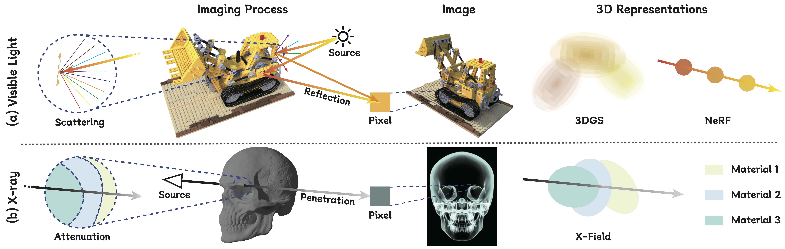

&nbsp;

<div align="center">

<p align="center">  </p>

[Paper](https://openreview.net/pdf?id=S8XcHutp7Z) | [Project Page](https://brack-wang.github.io/XField/)

<h2> X-Field: A Physically Informed Representation for 3D X-ray Reconstruction </h2>

Imaging Processes Comparison and Corresponding 3D Representations


</div>

&nbsp;

## Introduction

This is the official implementation of **X-Field (NeurIPS 2025 Spotlight)**.

If you find this repository useful, please give it a ⭐ and consider citing our paper!

---

## Installation


```bash
# Create conda environment
conda env create --file environment.yml
conda activate xfield

# Install custom CUDA rasterization kernels
pip install xfield/submodules/xfield-rasterization
pip install xfield/submodules/simple-knn


# Install TIGRE for data generation and initialization
wget https://github.com/CERN/TIGRE/archive/refs/tags/v2.3.zip
unzip v2.3.zip
pip install TIGRE-2.3/Python --no-build-isolation
```

---


## Implementation

### 1. Training

```bash
python train.py -s <data.pickle>
```

Training outputs (checkpoints, logs, rendered images) are saved to `output/<timestamp>/`.


### 3. Evaluation

Evaluate 2D projection rendering and compute metrics (PSNR, SSIM):

```bash
python test.py -m <model_path> -s <data.pickle>
```

Results are saved to `<model_path>/test/iter_<N>/`.

### 4. Render 360° Video

Generate a 360-degree rotating visualization:

```bash
python render360.py -m <model_path> -p <point_cloud.ply>
```

Output video saved to `<model_path>/360/`.

### 5. CT Reconstruction

Reconstruct 3D CT volume from rendered projections:

```bash
python recon_ct.py --data <data.pickle> --path <test_output_path> --method fdk
```

<details>
<summary><b>Available CT reconstruction methods</b></summary>

| Method | Description |
|--------|-------------|
| `fdk` | Feldkamp-Davis-Kress (default) |
| `sart` | Simultaneous Algebraic Reconstruction |
| `ossart` | Ordered Subset SART |
| `cgls` | Conjugate Gradient Least Squares |
| `asd_pocs` | ASD-POCS with TV regularization |
| `os_asd_pocs` | Ordered Subset ASD-POCS |

</details>

---

## Dataset

You can download the datasets (synthetic and real) used in our paper:

📦 **[Download Datasets](https://drive.google.com/drive/folders/1nBE5aEhlgWzCZlPM5ee_kYiJqZBAsr8Q?usp=sharing)**

<details>
<summary><b>Dataset Structure</b></summary>

```
data/
├── 0_foot_cone.pickle      # Foot CT scan (cone-beam)
├── 0_head_cone.pickle      # Head CT scan (cone-beam)
├── 0_chest_cone.pickle     # Chest CT scan (cone-beam)
├── 2_teapot_cone.pickle    # Teapot synthetic (cone-beam)
└── ...
```

Each `.pickle` file contains:
- X-ray projections
- Scanner geometry configuration
- Ground truth CT volume (for evaluation)

</details>

### Initialize Point Cloud (Optional)

Initialize Gaussian point cloud from CT reconstruction. This step is optional but can improve convergence.

```bash
python init_gaussians.py --data <data.pickle> --output <init.npy> --recon_method fdk
```

<details>
<summary><b>Available initialization methods</b></summary>

| Method | Description |
|--------|-------------|
| `random` | Random point sampling |
| `fdk` | FDK algorithm (default) |
| `cgls` | Conjugate Gradient Least Squares |
| `sart` | Simultaneous Algebraic Reconstruction |
| `hybrid_cgls_sart_tv` | Hybrid method with TV regularization |

</details>

---


## Citation

If you find **X-Field** useful for your research, please cite:

```bibtex
@inproceedings{wangx,
  title={X-Field: A Physically Informed Representation for 3D X-ray Reconstruction},
  author={Wang, Feiran and Tao, Jiachen and Wu, Junyi and Wang, Haoxuan and Duan, Bin and Wang, Kai and Yang, Zongxin and Yan, Yan},
  booktitle={The Thirty-ninth Annual Conference on Neural Information Processing Systems}
}

@article{wang2025x,
  title={X-Field: A Physically Grounded Representation for 3D X-ray Reconstruction},
  author={Wang, Feiran and Tao, Jiachen and Wu, Junyi and Wang, Haoxuan and Duan, Bin and Wang, Kai and Yang, Zongxin and Yan, Yan},
  journal={arXiv preprint arXiv:2503.08596},
  year={2025}
}
```

---

## Acknowledgements

This codebase builds upon [3D Gaussian Splatting](https://github.com/graphdeco-inria/gaussian-splatting), [X-Gaussian](https://github.com/caiyuanhao1998/X-Gaussian)， and [R²-Gaussian](https://github.com/Ruyi-Zha/r2_gaussian). We thank the authors for their excellent work.
